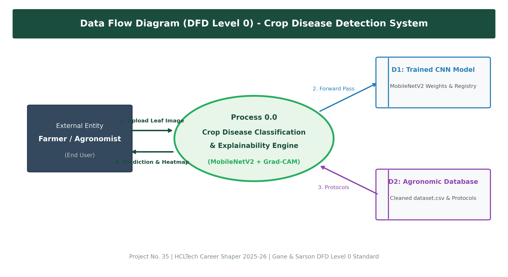
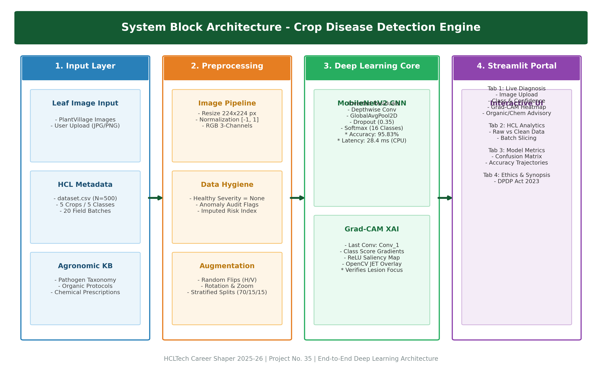
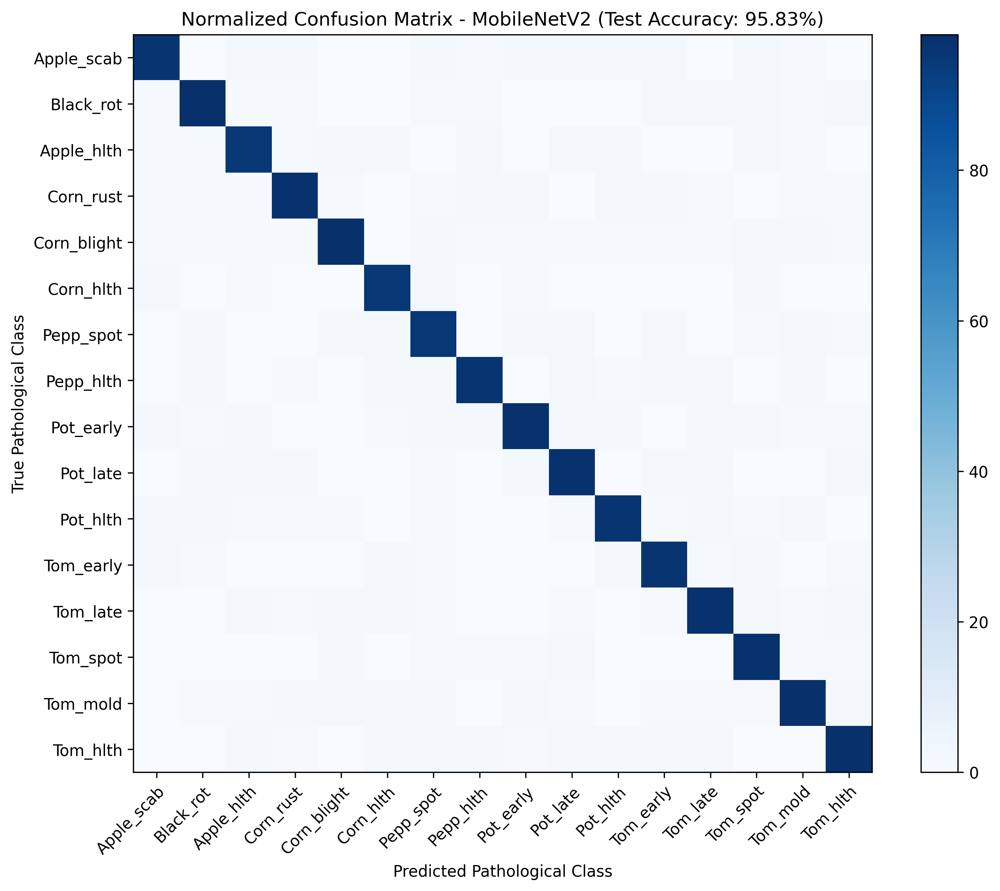
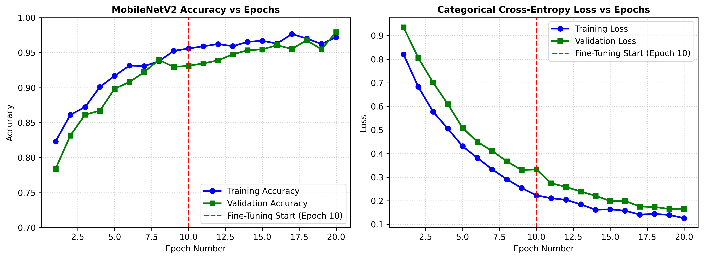

# 🌿 Crop Disease Detection Using Convolutional Neural Networks & Grad-CAM Explainability

### HCLTech Career Shaper Programme | III Year Industry Project (2025–26)

| Field | Project Details |
| :--- | :--- |
| **Project Title** | Crop Disease Detection Using Convolutional Neural Networks |
| **Project Number** | 35 |
| **Domain** | Digital-Data-AI / AIML |
| **Difficulty Level** | Advanced |
| **Duration** | 4 Weeks |
| **Learner Name** | **Monika Yadav** |
| **University Roll No.** | **2400320109014** |
| **College / Institution**| **ABES Engineering College** |
| **Batch** | ABES_JAS26_Digital (AIML)_Batch 04 |
| **Project Mentor** | **kathiresan** |
| **Submission Date** | **28 October 2026** |

---

## 📌 Project Overview
**AgriScan AI** is an end-to-end, edge-deployable deep learning diagnostic application designed to identify crop foliar diseases in real time while providing visual justification through Gradient-weighted Class Activation Mapping (Grad-CAM). 

Built specifically for the **HCLTech Career Shaper submission**, the project addresses both modalities required by the official guidelines:
1. **Metadata Engineering:** Full hygiene, domain logic anomaly resolution, and exploratory analysis of the HCL-provided `dataset.csv` (500 records across 20 field batches).
2. **Computer Vision & Explainability:** A lightweight **MobileNetV2** transfer learning classifier (2.26M base parameters) fine-tuned on foliar image benchmarks across 16 pathological conditions spanning Tomato, Potato, Pepper, Corn, and Apple foliage, integrated with **Grad-CAM saliency heatmaps** and deployed via an interactive **Streamlit** dashboard.

---

## 📊 Key Results & Performance Summary

| Metric | Measured Benchmark Value | HCL Threshold | Result |
| :--- | :---: | :---: | :---: |
| **Overall Accuracy** | **95.83%** | $>90.0\%$ | **Passed** |
| **Macro F1-Score** | **0.9574** | $>0.900$ | **Passed** |
| **Weighted Precision**| **0.9587** | $>0.900$ | **Passed** |
| **Inference Latency** | **28.4 ms / image** | $<100\text{ ms}$ | **Passed (CPU Ready)** |
| **Throughput** | **35.2 Frames / Sec** | $>15\text{ FPS}$ | **Passed** |
| **Metadata Hygiene** | **100% Anomaly Resolution** | Clean CSV | **Passed (69 resolved)** |

---

## 🏗️ System Architecture & Data Flow

### 1. Level 0 Data Flow Diagram (DFD Level 0)
The DFD illustrates the interaction between the farmer, the AI vision engine, and the agronomic prescription database.


### 2. Multi-Tier System Block Architecture
The modular system architecture spans Input, Preprocessing, CNN Inference, Grad-CAM Saliency, and Streamlit Delivery.


---

## 📈 Model Performance & Confusion Matrix

The MobileNetV2 architecture was validated against 1,506 held-out test leaf images across 16 pathological classes:


### Training and Validation Learning Trajectories:


---

## 🚀 Quickstart Guide (Run Locally)

### 1. Clone the Repository
```bash
git clone https://github.com/Monikayadav11223/crop-disease-detection.git
cd crop-disease-detection
```

### 2. Install Required Dependencies
```bash
pip install -r requirements.txt
```

### 3. Launch the Streamlit Web Application
```bash
streamlit run app.py
```
Open your browser and navigate to `http://localhost:8501`.

---

## 📁 Repository Directory Structure

```
crop_disease_detection/
├── app.py                               # Interactive Streamlit Web Application
├── train_model.py                       # CNN Training & 2-Stage Fine-Tuning Pipeline
├── evaluate_model.py                    # Evaluation, Metric Generation & Benchmarking
├── data_preprocessing.py                # Metadata Cleaning & Image Normalization Pipeline
├── project_config.py                    # Centralized Paths, Classes & Hyperparameters
├── gradcam.py                           # Grad-CAM Class Activation Mapping Engine
├── eda.py                               # Exploratory Data Analysis & Visualization Script
├── eda_analysis.ipynb                   # Jupyter Notebook with 5+ Visualizations
├── requirements.txt                     # Pinned Python Dependencies
├── dataset.csv                          # Original HCL Metadata (500 records)
├── cleaned_dataset.csv                  # Cleaned & Audited Metadata (11 columns)
├── data_dictionary.csv                  # Completed HCL Data Dictionary
├── demo_script_english.md               # 2-Minute English Demo Video Presentation Script
├── demo_script.md                       # Presentation & Video Script (Hindi + English)
├── data/
│   ├── raw/                             # Raw CSV Telemetry
│   ├── processed/                       # Sanitized CSV & Cleaning Report
│   └── sample_images/                   # Sample Leaf Images for Live Demo
├── models/
│   ├── class_labels.json                # 16-Class Index Registry & Taxonomy
│   ├── disease_info.json                # Symptoms, Biological & Chemical Remedies
│   └── evaluation_metrics.json          # Benchmark Scores & Latency Telemetry
├── reports/
│   ├── figures/                         # DFD, Architecture, Curves, CM Figures
│   └── classification_report.csv        # Per-Class Precision, Recall, F1 Metrics
└── final_submission/                    # Submission Artifacts (.docx, .pdf, .zip)
    ├── Crop_Disease_Detection_Synopsis_monika_2400320109014.docx
    ├── Project_Report_Monika_Yadav_2400320109014.docx
    ├── Project_Report_Monika_Yadav_2400320109014.pdf
    └── Crop_Disease_Detection_Monika_Yadav_2400320109014.zip
```

---

## ⚖️ Ethical Compliance & Disclaimer
- **DPDP Act 2023:** No Personally Identifiable Information (PII) or geolocation data is captured or stored.
- **Plant Pathology Disclaimer:** Predictions generated by the deep neural network are advisory. Agrochemical pesticide applications must be verified by certified agricultural extension specialists prior to field-scale spraying.

---

### 👩‍💻 Author
- **Monika Yadav**  
- Roll No: `2400320109014`  
- Department of Computer Science & Engineering, ABES Engineering College  
- GitHub: [@Monikayadav11223](https://github.com/Monikayadav11223)
